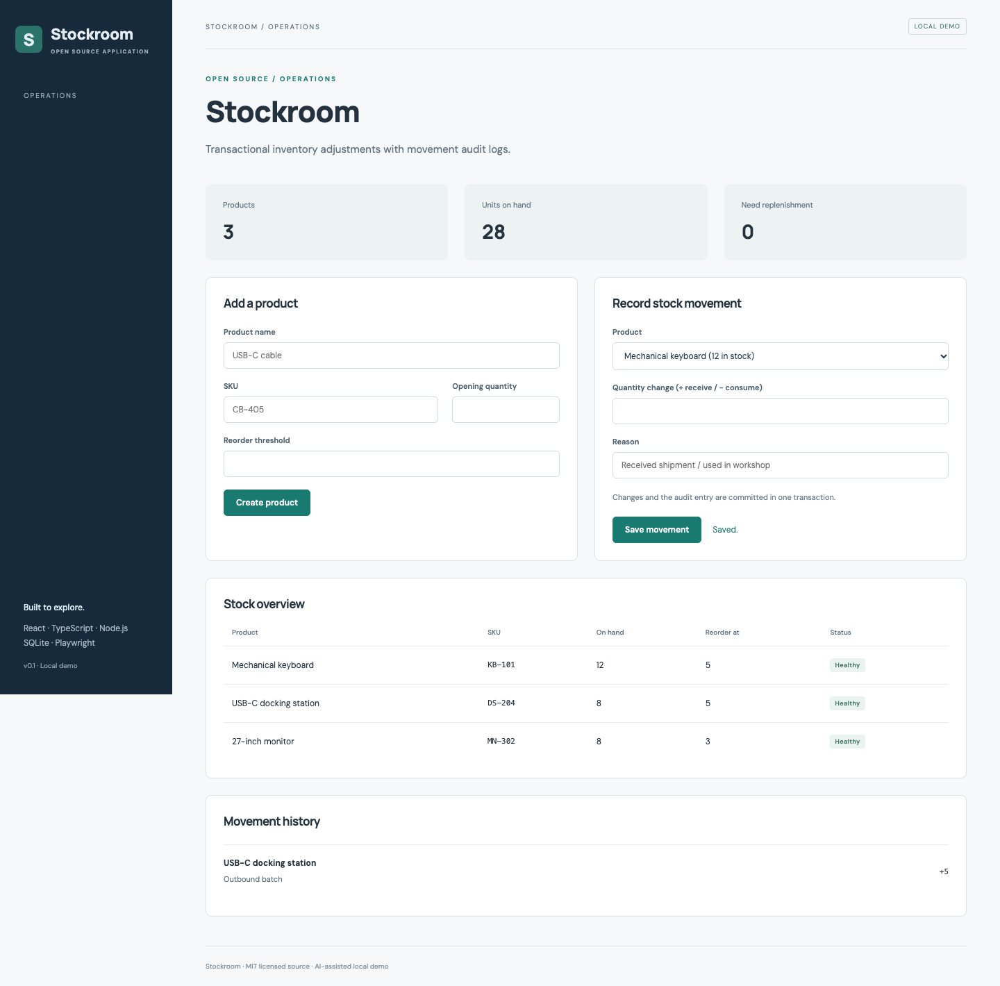

# Stockroom

Inventory operations. An independently runnable open source application.

## Run and demonstrate

From this repository, run `npm ci` and `npm run dev`. Open http://127.0.0.1:5173/#inventory.

Choose USB-C docking station. Try consuming more units than are available; the request is rejected. Receive five units and inspect the audit trail and low-stock indicator.

## Implementation and decisions

Each stock change and its audit record use one database transaction. Negative stock is rejected without partially writing an audit entry. SKU uniqueness and integer quantities are enforced.

API implementation: [`server/projects/inventory.ts`](server/projects/inventory.ts). The React workflow is in [`src/main.tsx`](src/main.tsx); storage initialization and shared middleware are in [`server/app.ts`](server/app.ts).

## API

- `GET /api/products` — stock list including low-stock flags.
- `POST /api/products` — create `{sku, name, quantity, threshold}`.
- `POST /api/products/:id/moves` — apply `{delta, note}` atomically; rejects insufficient stock with HTTP 409.
- `GET /api/stock-moves` — latest 100 audit entries.

## Verification

Run `npm test` for domain/API checks. Run `npm run build`, then `npm run test:e2e` for browser flows, including **Stockroom reports insufficient stock, then records a receipt**.

## Application description

> Stockroom: an inventory demo with transactional stock adjustments, movement audit logs, SKU uniqueness, and low-stock detection, implemented with React, TypeScript, Node.js, and SQLite.

Use this as a description of the current project. Add your own reviewed contribution and disclose AI assistance when discussing development. Do not attach invented employment dates, client claims, production usage, or years of experience.

## Next contribution

Add CSV export of the movement ledger, including formula-injection protection and export regression tests.

MIT licensed. Initial implementation created with AI assistance in October 2026; see [CONTRIBUTIONS.md](CONTRIBUTIONS.md).

## Scope

This is a single-user local demonstration with fictional data. It has no account authentication or multi-tenant authorization. Keep it bound to loopback. Initial code was developed with AI assistance in October 2026 and extracted from Portfolio Workbench.
